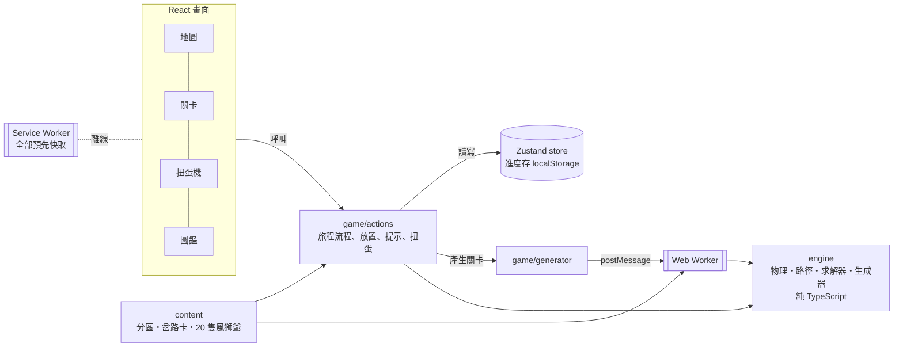

# 小獅搭路（暫名）發展計畫

> 狀態：v0.3.0（2026-10-15）。遊戲正式名稱還在討論，repo 暫名 `shisa-reunion`，畫面與安裝名稱暫用「小獅搭路」。

## 1. 目標

把家裡孩子在玩的實體搭路益智桌遊玩法，做成一款**可以安裝、沒有網路也能玩**的網頁遊戲，主要在平板和手機上玩。

- 核心玩法：用有重力、會倒的積木搭一條路，讓出發的風獅爺走到等待的風獅爺身邊
- 包裝：沖繩主題、roguelike 隨機關卡、分區難度、過關拿福氣幣抽扭蛋收集風獅爺
- 原型已在兩版 Artifact 驗證（v0.1 固定 16 關、v0.2 roguelike＋扭蛋），v0.3 起轉成正式專案

## 2. 版權與智慧財產評估（摘要）

完整理由與替代方案見 [ADR-0005](adr/0005-original-expression-ip-stance.md)。

| 項目 | 是否受保護 | 我們的做法 |
| --- | --- | --- |
| 遊戲規則、玩法、機制（搭路、重力、階梯） | **不受著作權保護**。台灣著作權法第 10 條之 1：保護「僅及於表達，不及於思想、程序、系統、操作方法、概念」；美國著作權局對遊戲的說明也相同 | 可以使用，並已自行延伸（竹梯、跳跳貝、漲潮、石門機關等） |
| 美術、角色、包裝、說明文字 | 受著作權保護 | 全部原創：沖繩風獅爺、紅型／赤瓦／紅芋造型，不用騎士與公主，也不用城堡積木塗裝 |
| 官方 48 關題目卡 | 題目編排可能被認定為表達 | 不抄。關卡全部由程式當場產生、求解器驗證 |
| 名稱與商標（Camelot、SmartGames） | 受商標保護 | 遊戲名、安裝名、商店頁、宣傳都不使用；文件內只做事實性提及 |
| 整體外觀與手感（look and feel） | 美國 *Tetris v. Xio*（2012）判決：整體視覺近似可構成侵權 | 視覺風格刻意與原作不同 |
| 專利 | 公開資料查無 Camelot Jr. 的相關專利；原廠 Smart NV 有部分實體產品的設計專利（保護外觀，不及於數位玩法） | 個人與家庭使用風險低；**若要商業化，上架前請專業人士做一次侵權可能性檢索（FTO）** |
| 字型 | LXGW WenKai TC 與 Fredoka 皆為 SIL OFL 1.1 | 自託管子集字型，授權檔隨附於 `public/fonts/` |

結論：公開 repo、個人與家庭使用都沒有問題。之後若要商業化（上架、收費、廣告），再做一次正式的智財檢索。

> 本節是工程端的整理，不構成法律意見。

## 3. 架構



- **規則引擎與畫面完全分開**：`src/engine` 不碰 DOM，可單獨測試，也能拿去做關卡編輯器、實體挑戰卡產生器（[ADR-0002](adr/0002-pure-engine-and-worker-generator.md)）
- **關卡在 Web Worker 產生**：求解器跑重的時候不會卡畫面
- **同一個種子產生同一關**：旅程可以重現、方便回報問題

### 目錄

```
src/
  engine/      規則引擎：pieces（積木定義）、grid（重力與重心）、path（走路、爬梯、彈跳）、solver、generator
  content/     遊戲內容：zones（分區、岔路卡、各站設定）、shisa（20 隻風獅爺與扭蛋抽法）、text（名稱與規則說明）
  state/       Zustand store；只有 progress 會存檔，ui 是暫時狀態
  game/        旅程流程（actions）、拖放、走路動畫、盤面與托盤元件、Worker 呼叫端
  art/         SVG 美術元件：積木、場景、機關、風獅爺、圖示
  screens/     地圖、關卡、扭蛋機、圖鑑
  modals/      新積木說明、過關、岔路、旅程完成、扭蛋開獎、選擇出場
  workers/     關卡產生 Worker
scripts/       字型子集化（pnpm fonts）、圖示產生（pnpm icons）
e2e/           Playwright 測試
docs/adr/      架構決策紀錄
```

## 4. 技術選型

| 範圍 | 選擇 | 決策 |
| --- | --- | --- |
| 框架 | React 19 + Vite 8 + TypeScript 7 | [ADR-0001](adr/0001-react-vite-typescript.md) |
| 狀態 | Zustand 5（persist、immer middleware） | ADR-0001 |
| 程式品質 | Biome 2（lint＋format） | ADR-0001 |
| 測試 | Vitest 5（單元）、Playwright（端對端，用系統 Chrome） | 本文第 6 節 |
| PWA | vite-plugin-pwa（Workbox generateSW） | [ADR-0003](adr/0003-offline-first-pwa.md) |
| 部署 | Vercel Hobby（個人帳號 aaronchuo） | [ADR-0004](adr/0004-vercel-hobby-hosting.md) |
| 套件管理 | pnpm 10 | — |

## 5. PWA 與離線

- 第一次打開就把整個遊戲（程式、Worker、字型、圖示）預先存進快取，之後完全不用網路
- 中文字型只保留遊戲用到的 494 個字（每個字重約 140 KB；完整字檔各 15 MB）。新增中文文字後執行 `pnpm fonts` 重建，單元測試會擋下漏掉的字
- 有新版本時，地圖畫面會顯示「有新版本可以更新了」，**由玩家決定何時更新**，不會在解題到一半時自動重新載入
- iPad／iPhone：用 Safari 打開 → 分享 → 加入主畫面。加到主畫面後，iOS 不會因為一段時間沒用就清掉進度
- 進度只存在該裝置。換裝置或清除網站資料後，收集會不見（雲端備份列在路線圖）

## 6. 品質把關

| 層級 | 內容 |
| --- | --- |
| 單元測試 | 物理（懸空平衡、石拱橋重心、有東西壓著就拿不起來）、路徑（爬梯、彈跳、海膽、漲潮、石門）、每個分區 × 每一站 × 每張岔路卡都能產生公平關卡、同種子可重現、扭蛋不重複、字型涵蓋 |
| 端對端測試 | 用滑鼠實際拖積木走完那霸港五站並抽扭蛋、離開後續玩、斷網後重新整理還能開始旅程、手機版面（Pixel 7 與 375×600 兩種尺寸：扭蛋分類都點得到、文字不壓在機台上、不會左右捲動） |
| CI | GitHub Actions：lint → type-check → 單元測試 → build → 端對端測試 |

## 7. 部署

- Vercel 專案在個人帳號 `aaronchuo's projects`，Hobby 方案（免費，限非商業用途）
- 連上 GitHub 後：推到 `main` 自動部署正式環境，其他分支與 PR 自動產生預覽網址
- `vercel.json` 讓 `sw.js` 不被快取，確保新版本能被發現；`/assets/*` 帶雜湊檔名，設為永久快取

## 8. 路線圖

| 版本 | 主題 | 內容 |
| --- | --- | --- |
| **v0.3**（本版） | 架構化 | React 重構、PWA 離線、測試與 CI、部署 Vercel |
| v0.4 | 試玩與命名 | iPad／手機實機試玩、調難度曲線、正式命名（repo、manifest、畫面一起改） |
| v0.5 | 小孩體驗 | 「走走看」：路還沒通也能讓獅子走到卡住的地方；影子提示；岔路卡預覽關卡 |
| v0.6 | 內容 | 新扭蛋系列、新積木與機關（溜滑梯、蹺蹺板）、每日一題 |
| v0.7 | 家長 | 進度匯出／匯入或雲端備份、遊玩時間提醒 |
| 之後 | 延伸 | 關卡編輯器（小孩出題、求解器驗證）、實體挑戰卡產生器（用實體積木的數量出新題） |

## 9. 待決事項

1. **遊戲正式名稱**：repo 暫名 `shisa-reunion`（取「兩隻獅子重逢」），畫面暫名「小獅搭路」
2. **授權條款**：目前沒有附 LICENSE，等於保留所有權利。若想開源程式碼可選 MIT，美術另外約定
3. **待辦追蹤**：個人專案不放進公司 ClickUp，建議用這個 repo 的 GitHub Issues
