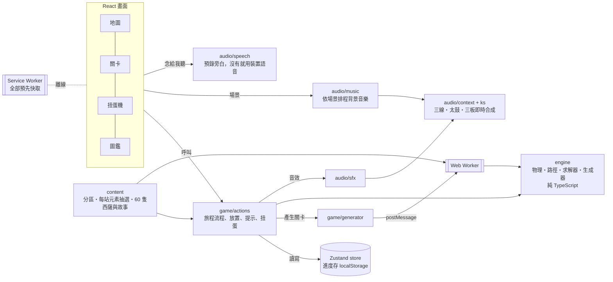

# 西薩搭搭路發展計畫

> 狀態：v0.26.1（2026-10-25）。遊戲正式名稱「西薩搭搭路」（[ADR-0019](adr/0019-official-name.md)）；repo、網址與存檔仍用 `shisa-reunion`。待辦記在 [GitHub Issues](https://github.com/AaronChuo/shisa-reunion/issues)。

## 1. 目標

把家裡孩子在玩的實體搭路益智桌遊玩法，做成一款**可以安裝、沒有網路也能玩**的網頁遊戲，主要在平板和手機上玩。

- 核心玩法：用有重力、會倒的積木搭一條路，讓出發的西薩走到等待的西薩身邊
- 包裝：沖繩主題、roguelike 隨機關卡、分區難度、過關拿福氣幣抽扭蛋收集西薩
- 原型已在兩版 Artifact 驗證（v0.1 固定 16 關、v0.2 roguelike＋扭蛋），v0.3 起轉成正式專案

## 2. 版權與智慧財產評估（摘要）

完整理由與替代方案見 [ADR-0005](adr/0005-original-expression-ip-stance.md)。

| 項目 | 是否受保護 | 我們的做法 |
| --- | --- | --- |
| 遊戲規則、玩法、機制（搭路、重力、階梯） | **不受著作權保護**。台灣著作權法第 10 條之 1：保護「僅及於表達，不及於思想、程序、系統、操作方法、概念」；美國著作權局對遊戲的說明也相同 | 可以使用，並已自行延伸（竹梯、跳跳貝、溜滑梯、藤蔓、漲潮、石門、星砂、可以轉方向的形狀積木等） |
| 美術、角色、包裝、說明文字 | 受著作權保護 | 全部原創：沖繩西薩（守護獅）、紅型／赤瓦／紅芋造型，不用騎士與公主，也不用城堡積木塗裝 |
| 官方 48 關題目卡 | 題目編排可能被認定為表達 | 不抄。關卡全部由程式當場產生、求解器驗證 |
| 名稱與商標（Camelot、SmartGames） | 受商標保護 | 遊戲名、安裝名、商店頁、宣傳都不使用；文件內只做事實性提及 |
| 整體外觀與手感（look and feel） | 美國 *Tetris v. Xio*（2012）判決：整體視覺近似可構成侵權 | 視覺風格刻意與原作不同 |
| 專利 | 公開資料查無 Camelot Jr. 的相關專利；原廠 Smart NV 有部分實體產品的設計專利（保護外觀，不及於數位玩法） | 個人與家庭使用風險低；**若要商業化，上架前請專業人士做一次侵權可能性檢索（FTO）** |
| 字型 | 源泉圓體（GenSen Rounded TW）與 Fredoka 皆為 SIL OFL 1.1 | 自託管子集字型，授權檔隨附於 `public/fonts/` |
| 明信片照片 | 受著作權保護（屬於拍攝者） | 只用自己拍的、公眾領域或 CC BY，逐張標示作者、授權與修改方式（[ADR-0012](adr/0012-postcard-photo-licensing.md)） |
| 配樂 | 作者不詳的傳統民謠，旋律已是公共財；近代的改編、歌詞與錄音仍受保護 | 只取旋律、用程式自己合成，不用歌詞、近代編曲或錄音；其餘是原創曲（[ADR-0006](adr/0006-synthesized-sanshin-audio.md)） |

結論：公開 repo、個人與家庭使用都沒有問題。之後若要商業化（上架、收費、廣告），再做一次正式的智財檢索（[#15](https://github.com/AaronChuo/shisa-reunion/issues/15)）。

repo 公開但不開源：[LICENSE](../LICENSE) 寫明保留所有權利，照片、字型等第三方素材依各自的授權（ADR-0005 v0.18 補充）。

> 本節是工程端的整理，不構成法律意見。

## 3. 架構



- **規則引擎與畫面完全分開**：`src/engine` 不碰 DOM，可單獨測試，也能拿去做關卡編輯器、實體挑戰卡產生器（[ADR-0002](adr/0002-pure-engine-and-worker-generator.md)）
- **逆築**：關卡先搭出解再反推（先把路搭好，再把積木收回托盤），求解器當裁判驗證公平，和「抽了再驗」輪流（[ADR-0015](adr/0015-backbuild-level-generation.md)）；有藤蔓的站先架好掛點再搭（[ADR-0020](adr/0020-vine-backbuild-and-solver-pruning.md)）；搭之前先算「剩下的積木補不補得完」，補不完的地形和半成品直接放棄（[ADR-0022](adr/0022-shortfall-and-narrower-relax.md)）。`pnpm bench:gen` 比較兩種方法的速度與關卡特徵，`pnpm bench:sweep` 用遊戲的時間預算依序生成全部組合、列出最慢的關卡
- **放寬條件先縮地基**：一直生不出時，先縮窄地基，真的不行才拿掉「下一站」卡片上畫的元素（ADR-0022）
- **求解器只搜有希望的盤面**：走路規則只看相鄰的欄，之後放的積木只會改到它蓋住的欄，算得出哪些盤面之後怎麼放都贏不了就跳過；結果和舊求解器完全一樣，困難關卡快 5–46 倍（ADR-0020）。`pnpm bench:solver` 比較新舊求解器
- **關卡在 Web Worker 產生**：求解器跑重的時候不會卡畫面
- **同一個種子產生同一關**：旅程可以重現、方便回報問題

### 目錄

```
src/
  engine/      規則引擎：pieces（積木定義）、grid（重力、重心、藤蔓懸掛）、path（走路、爬梯、彈跳、溜滑梯、撿星砂路線）、solver（求解器，也是裁判；solver.reference 是剪枝前的版本，只給對照測試用）、backbuild（逆築：先搭出解，藤蔓站先架掛點）、generator（抽地形、兩種方法輪流、放寬條件）
  content/     遊戲內容：zones（分區與等級、每站元素抽選、各站設定、解鎖規則）、shisa（60 隻西薩、文化小故事與扭蛋抽法）、text（名稱與規則說明）
  state/       Zustand store；只有 progress 會存檔（分區用 id 記，舊存檔載入時自動升級），ui 是暫時狀態
  gacha/       可以用手操作的扭蛋機：physics（扭蛋在玻璃罩裡的重力、碰撞、滾動）、Machine（投幣、轉把手、出口）
  game/        旅程流程（actions）、拖放、走路動畫、手指拖曳示範、盤面與托盤元件、Worker 呼叫端
  art/         SVG 美術元件：積木、場景、機關、西薩、圖示
  screens/     地圖、關卡、扭蛋機、圖鑑
  story/       開場故事「西薩的故事」
  places/      地方明信片的插畫
  modals/      新積木說明、過關、下一站、旅程完成、扭蛋開獎、西薩故事與選擇出場、西薩是什麼
  ui/          主要按鈕（Cta）、閒置偵測、更新提示
  workers/     關卡產生 Worker
  audio/       ks（三線撥弦合成）、context（音軌與太鼓、三板）、music（背景音樂排程）、sfx（音效）、songs（曲目）、speech（念給我聽：播預錄的旁白，沒有就用裝置語音）、voice（錄音的聲音設定與檔名）、voiceLines（所有要念的句子）
scripts/       字型子集化（pnpm fonts）、圖示產生（pnpm icons）、明信片照片（pnpm photos）、旁白錄音（pnpm voice）
e2e/           Playwright 測試
docs/adr/      架構決策紀錄
```

## 4. 技術選型

| 範圍 | 選擇 | 決策 |
| --- | --- | --- |
| 框架 | React 19 + Vite 8 + TypeScript 7 | [ADR-0001](adr/0001-react-vite-typescript.md) |
| 狀態 | Zustand 5（persist、immer middleware） | ADR-0001 |
| 程式品質 | Biome 2（lint＋format） | ADR-0001 |
| 測試 | Vitest 5（單元）、Playwright（端對端，用系統 Chrome） | 本文第 10 節 |
| PWA | vite-plugin-pwa（Workbox generateSW） | [ADR-0003](adr/0003-offline-first-pwa.md) |
| 部署 | Vercel Hobby（個人帳號 aaronchuo） | [ADR-0004](adr/0004-vercel-hobby-hosting.md) |
| 套件管理 | pnpm 10 | — |

## 5. PWA 與離線

- 第一次打開就把整個遊戲（程式、Worker、字型、圖示）預先存進快取，之後完全不用網路
- 中文字型用源泉圓體（台灣字形的圓黑體，字的大小一致、筆畫圓潤，適合孩子看），只保留遊戲用到的 930 個字（一般與粗體各約 220 KB）。v0.8 前用的霞鶩文楷是手寫楷書，字的大小天生不一，孩子看起來忽大忽小，所以換掉。新增中文文字後執行 `pnpm fonts` 重建，單元測試會擋下漏掉的字
- 有新版本時，地圖畫面會顯示「有新版本可以更新了」，**由玩家決定何時更新**，不會在解題到一半時自動重新載入
- iPad／iPhone：用 Safari 打開 → 分享 → 加入主畫面。加到主畫面後，iOS 不會因為一段時間沒用就清掉進度
- 進度只存在該裝置。換裝置、清除網站資料或刪掉主畫面圖示之前，先在「大人設定」備份；備份碼貼到新裝置的「還原進度」就能接著玩（[ADR-0025](adr/0025-backup-codes.md)）

## 6. 音樂與音效

決策見 [ADR-0006](adr/0006-synthesized-sanshin-audio.md)。

- 三線、太鼓、三板全部用程式即時合成，不需要任何音訊檔，離線也能播
- 背景音樂依場景切換：

| 場景 | 曲子 | 由來 |
| --- | --- | --- |
| 地圖 | 島風 | 原創，琉球音階慢板 |
| 那霸市 | てぃんさぐぬ花 | 傳統童謠（鳳仙花） |
| 美國村 | 夕陽海堤 | 原創，琉球音階，輕快地沿著海堤走向夕陽 |
| 讀谷村 | 谷茶前 | 傳統舞蹈歌，谷茶在讀谷旁的恩納村 |
| 恩納村 | 萬座毛 | 原創，琉球音階慢板，長長的樂句像吹過崖上草原的風 |
| 美麗海 | 唐船ドーイ | 傳統歌謠，唐船（中國的船）進港時的歡騰，常在宴會最後大家一起跳 |
| 古宇利島 | 花ぬ風車 | 傳統舞蹈歌 |
| 沖繩山原 | デンサー節 | 西表島上原流傳的八重山民謠（原本西表島的曲子，跟著藤蔓一起搬來） |
| 海中道路 | 海上的路 | 原創，琉球音階，艾薩太鼓節奏，像開車跑在海上 |
| 中城城跡 | 石拱門 | 原創，琉球音階，像拱門一樣往上爬再落下 |
| 南城市 | 東方的海 | 原創，琉球音階慢板，從海邊望向東方的神之島 |
| 首里城 | 赤田首里殿內 | 首里流傳的童謠 |
| 久米島 | 久米阿嘉節 | 久米島阿嘉村流傳的傳統曲，取自 1925 年印行的工工四（三線譜） |
| 宮古島 | 豊年の歌 | 宮古的祈豐收古歌，作者不詳 |
| 石垣島 | 安里屋ユンタ | 竹富島名曲（宮良長包 1934 年改編版旋律），竹富島就在石垣島旁邊 |
| 扭蛋機、圖鑑 | 搭路小調 | 原創，輕快 |

- 每區最後一站：同一首曲子加快 8%，配上艾薩太鼓節奏
- 音效：放積木的音高隨高度沿琉球音階往上爬；彈跳是三線滑音；溜滑梯是一路往下滑的長音；攀藤蔓兩聲輕撥；撿到星砂是一串高音；石門打開兩聲太鼓；過關是一段琉球音階樂句加太鼓、三板

## 7. 內容：分區與西薩故事

決策見 [ADR-0007](adr/0007-culture-stories-and-read-aloud.md)、[ADR-0013](adr/0013-one-new-element-per-zone.md)、[ADR-0014](adr/0014-wide-ground-and-scenery-roads.md)、[ADR-0016](adr/0016-three-new-zones.md)、[ADR-0018](adr/0018-bigger-ground.md)、[ADR-0029](adr/0029-fourteen-zones.md)。

14 個分區照地圖順序繞沖繩一圈：沿本島西海岸往北到山原，從東海岸往南到南城，再出海到久米島、宮古島、石垣島。

| 分區 | 等級 | 新元素（第一站教學） | 最後一站 |
| --- | --- | --- | --- |
| 那霸市 | 入門 ★ | 無，只練搭路 | 國際通（積木多、解法少） |
| 美國村 | 初級 ★★ | 無，只練搭路 | 日落海灘 |
| 讀谷村 | 初級 ★★ | 竹梯 | 殘波岬（竹梯） |
| 恩納村 | 進階 ★★★ | 跳跳貝 | 萬座毛（跳跳貝＋1 種學過的） |
| 美麗海 | 進階 ★★★ | 無，從學過的抽 | 翡翠海灘（1 種學過的） |
| 古宇利島 | 進階 ★★★ | 海膽 | 心形岩（海膽＋1 種學過的） |
| 沖繩山原 | 高手 ★★★★ | 藤蔓：掛在積木下面，可以攀上攀下 | 邊戶岬（藤蔓＋1–2 種學過的） |
| 海中道路 | 高手 ★★★★ | 無，從學過的抽 | 伊計島（1–2 種學過的） |
| 中城城跡 | 高手 ★★★★ | 石拱橋：兩頭都要撐住才放得穩，下面可以鑽過去 | 石拱門（石拱橋＋1–2 種學過的） |
| 南城市 | 高手 ★★★★ | 無，從學過的抽（自己的新元素之後再做） | 齋場御嶽（1–2 種學過的） |
| 首里城 | 大師 ★★★★★ | 石門：積木壓住壓板才會開 | 守禮之門（石門＋1 種學過的） |
| 久米島 | 大師 ★★★★★ | 漲潮：放好兩塊積木海水就漲上來，畫面用水滴倒數 | 果之濱（漲潮＋1 種學過的） |
| 宮古島 | 大師 ★★★★★ | 溜滑梯：只能從高的那頭往下溜 | 砂山海灘（溜滑梯＋1 種學過的） |
| 石垣島 | 大師 ★★★★★ | 星砂：要先撿到才能去找朋友 | 川平灣（星砂＋1 種學過的） |

- 第 2–4 站從「新元素＋學過的元素」裡隨機抽 0–3 種，數量依等級、新元素權重較高且至少出現兩站
- 形狀積木依等級加進每區的積木池，每種都能轉方向：入門有金楚糕（一直排 3 格），初級加石牆角（L 形），進階以上再加海灘陽傘（T 形）與浪花（S 形，轉兩次後翻面）；赤瓦塔可以橫躺（[ADR-0027](adr/0027-shape-blocks.md)）
- 不會同一站出現的組合（生成太慢或生不出來）：石門＋星砂／漲潮／石拱橋／藤蔓／溜滑梯、藤蔓＋跳跳貝／漲潮／石拱橋／溜滑梯、石拱橋＋星砂；一站最多兩種特殊積木，有兩種時不再加機關
- 每站之間有一張「下一站」卡，用圖示預告下一站有什麼
- 地基寬度：入門、初級 6 格，進階 7 格，高手 9 格，大師 10 格；托盤積木：入門 1–3、初級 2–3、進階以上 2–4 塊。有石門的站最多 4 塊（藤蔓的上限 v0.19 拿掉，石門的寬度與漲潮的上限 v0.20 拿掉）。手機放得下就縮小看全景，太小才改成左右捲動
- 風景路：入門、初級、進階各一次岔路，高手兩次，大師三次；每區三條真實地名的路（白天、黃昏、夜晚各一），只換畫面不換關卡
- 解鎖：走完入門開初級，之後每級走完「總數少一個」的分區就開下一級：初級走完 1 區開進階、進階走完 2 區開高手、高手走完 3 區開大師
- v0.27 換成 14 區時，竹富島的進度交給石垣島、西表島的交給山原（同一種新元素、同一帶）；打開過的地區不會再關起來（[ADR-0029](adr/0029-fourteen-zones.md)）

- 扭蛋七個系列共 60 隻：傳統、海洋、美食、祭典、離島各 10 隻，動物、工藝各 5 隻；每個系列都有稀有款
- 離島系列（v0.16）：宮古上布、久米島紬、大東島、與那國馬、慶良間鹿、伊江島百合、泥巴神（パーントゥ）、水牛車、神之島（久高島），稀有款是波照間島的南十字星西薩；扭蛋機屋頂是有椰子樹、燈塔和渡輪的小島
- 每隻西薩附一段 50–75 字的小故事，講牠的由來、典故或沖繩文化，寫給大孩子自己讀、或爸媽念給孩子聽；圖鑑另有一頁「西薩是什麼？」
- 年份、數字、紀錄等具體事實都查證過；沒把握的細節寫得概括，不寫死
- 「念給我聽」播 Azure 台灣國語語音（曉臻）預先錄好的旁白，沒有錄音時用裝置內建的國語語音（[ADR-0021](adr/0021-azure-narration.md)）；日文詞一律寫成中文音譯在前、日文放括號，例如「西薩（シーサー）」，朗讀時只念音譯

### 地方明信片

決策見 [ADR-0011](adr/0011-place-postcards.md)。沖繩和 14 個分區各有一張明信片：真實照片（授權見 [ADR-0012](adr/0012-postcard-photo-licensing.md)，只用自己拍的、公眾領域或 CC BY，並標示作者）、兩三個找找看的小標籤、一段可以念給孩子聽的介紹。v0.27 新加的六區沒有照片，用美術為該區畫的白天場景（`public/scenes/<分區>/day.webp`），等插畫明信片來了再一起換（[ADR-0029](adr/0029-fourteen-zones.md)）。換成自己拍的照片：放到 `.cache/photos/<地點>.jpg`、改 `src/content/photos.json`、跑 `pnpm photos`。第一次到一個分區時先看到它的明信片；地圖圖釘也改成打開明信片（上面有「出發」）；沖繩的明信片在地圖左上角。圖鑑分成「西薩」和「明信片」兩頁，去過的地方才收進明信片頁。

## 8. 主角西薩與開場故事

決策見 [ADR-0010](adr/0010-shisa-name-and-opening-story.md)。

- 遊戲裡一律叫「西薩」（沖繩話シーサー的音譯，就是「獅子」）；每一隻叫「○○西薩」。英文 Shisa 只用在標誌、網址、英文名
- 第一次打開遊戲會播一本五頁的小繪本「西薩的故事」，地圖上的「故事」按鈕可以重看：
  1. 屋頂上的兩隻獅子，點一下牠會說「我是西薩！」，名牌跳出來
  2. 張嘴的把福氣接進來、閉嘴的把福氣守住（就是遊戲裡的出發和等待）
  3. 用手指撥一下吹起颱風，兩隻西薩被吹散
  4. 一塊石階掉下來，出發的西薩走上去找到朋友
  5. 「出發」直接開始第一關
- 每頁都會念出來（曉臻的預錄旁白；西薩說話是同一個聲音調高 30%），有聲音開關和「跳過」
- 點地圖上方的兩隻西薩、或關卡裡的西薩，牠會說自己的名字；過關時喊「西薩團聚了！」

## 9. 不識字也會玩

決策見 [ADR-0008](adr/0008-buttons-for-children-who-cannot-read.md)。5 歲孩子試玩後的調整：

- 每個畫面只有一顆橘色、會呼吸的「主要下一步」，圖案在前、文字在後；孩子一陣子沒動作就有手指點著它（3–5 歲 4.5 秒、6–8 歲 8 秒、9 歲以上不出現）
- 其他按鈕白底、比較小，全部配圖示
- 少問一題：首頁自動選好下一站；扭蛋開獎只剩「換牠出場」和「先收著」；沒幣時主要按鈕變成「去玩，拿福氣幣」
- 用圖代替字：出發／等待用張嘴、閉嘴的獅子圖卡；獎勵與積木數量用圖示
- 第一關有手指示範拖曳，之後的提示也用手指示範；卡住一陣子提示貝殼會搖（3–5 歲 25 秒、6–8 歲 45 秒、9 歲以上不搖）
- 「走走看」：西薩沿著現在搭好的路走，走到路斷的地方停下來再跳回起點，讓孩子看見缺在哪裡；不限次數、不扣東西（[ADR-0026](adr/0026-try-walk.md)）
- 手機開了「減少動態效果」時，只停一直重複的裝飾動畫；西薩走路、故事、扭蛋飛出來和示範手指照樣播，只是不旋轉（[ADR-0028](adr/0028-less-motion-keeps-the-story.md)）

### 大人設定

決策見 [ADR-0023](adr/0023-who-is-playing.md)。在「聲音設定」裡按住「大人設定」1.5 秒才打得開：

- **誰在玩**：3–5 歲、6–8 歲、9 歲以上與大人，決定手指提示、提示貝搖動的時間和休息提醒的預設。第一次回到地圖時會問一次
- **休息提醒**：15–60 分鐘或不提醒；時間到了在過關後或回到地圖時，西薩提醒休息，不會在搭路途中打斷（[ADR-0024](adr/0024-rest-reminder.md)）
- **進度備份**：複製備份碼或存成檔案；還原前先比對備份和這台裝置的進度（[ADR-0025](adr/0025-backup-codes.md)）

### 扭蛋機

決策見 [ADR-0009](adr/0009-hands-on-gacha-machine.md)。把福氣幣拖進投幣口、手指按住把手轉一圈（只能順時針，每 90 度喀一聲），最下面的扭蛋就掉進出口，點它打開。玻璃罩裡的扭蛋數量就是這台還沒抽到的數量，會因重力堆在底部、碰撞、滾動；掉出一顆時其他顆滾下來補位。抽到誰仍由原本的公平規則決定，物理只決定哪一顆掉出來。點一下、或按主要按鈕也能完成每一步。

每台扭蛋機的屋頂依系列有自己的造型，屋頂上坐著該系列的稀有西薩當大獎：傳統是赤瓦、海洋是捲浪和小魚、美食是一大碗沖繩麵、祭典是紅白棚和燈籠、動物是森林樹冠、工藝是織著敏沙花紋的釉色屋頂、離島是有椰子樹、燈塔和渡輪的小島。把手和投幣口放大，把手上有紅色握把。扭蛋開獎時會從出口旋轉著飛到畫面正中央。

## 10. 品質把關

| 層級 | 內容 |
| --- | --- |
| 單元測試 | 扭蛋物理（會停下、不重疊、會滾、掉一顆後其他顆補位）、積木物理（懸空平衡、石拱橋重心、有東西壓著就拿不起來、藤蔓只能掛在積木下面、形狀積木每個方向都是前一個轉 90 度、金楚糕與 L 形與陽傘的平衡）、路徑（爬梯、彈跳、溜滑梯單向、攀藤蔓、海膽、漲潮、石門、星砂路線不能穿過終點）、每個分區所有可能的元素組合都能產生公平關卡且元素不被放寬拿掉、逆築搭出的路每塊都要用且符合該站要求（石門有壓、必要動作有做）、每站元素抽選（數量上限、新元素至少兩站、只抽學過的）、依等級解鎖、風景路與岔路次數、地基縮放（放得下就看全景、太小才捲動）、同種子可重現、過關時預先生成的下一關會直接拿來用、扭蛋不重複、故事長度與音譯、舊存檔升級、字型涵蓋 |
| 端對端測試 | 新玩家第一次打開會播開場故事（點西薩會說名字、撥一下吹起颱風、最後直接開始第一關）、可以跳過且之後不再自動播、地圖可重看；其他測試預設略過故事（`e2e/fixtures.ts`）；用滑鼠實際拖積木走完那霸市五站並抽扭蛋、首頁只有一顆主要按鈕且閒置會出現手指、第一關有拖曳示範且不扣提示貝、沒幣時扭蛋機改成「去玩」、拖幣進投幣口與畫圈轉把手才掉扭蛋（倒轉、沒投幣都不會掉）、扭蛋數量等於還沒抽到的數量、角色圖卡、每個有新元素的分區第一站都能玩到過關、舊存檔升級後首里城仍開著並依等級打開其他分區、圖鑑故事朗讀只念中文音譯、離開後續玩、斷網後重新整理還能開始旅程、選風景路後盤面換成那個時段、窄螢幕地基左右捲動且拖空地能平移、手機版面（Pixel 7 與 375×600 兩種尺寸：扭蛋分類都點得到、文字不壓在機台上、不會左右捲動） |
| CI | GitHub Actions 兩個平行的 job：一個是 lint → type-check → 單元測試 → build → 端對端測試，另一個跑生成全掃描 |

生成全掃描（每個分區所有可能的元素組合）最花時間，和其他單元測試分開：`pnpm test` 只跑快的（約 2 秒），`pnpm test:gen` 跑全掃描和其他較慢的測試（`*.slow.test.ts`，例如新舊求解器對照），`pnpm test:all` 全跑。全掃描依 CPU 核心數拆成幾份平行跑，檢查每個組合都生得出公平、元素齊全的關卡；平行時有些份會排到較慢的核心，所以給生成器 3 倍的時間預算。速度用 `pnpm bench:gen` 量，改生成器時都要跑。

## 11. 部署

- Vercel 專案在個人帳號 `aaronchuo's projects`，Hobby 方案（免費，限非商業用途）
- **專案沒有連 GitHub**，推到 `main` 不會部署。正式環境用 CLI 部署：把要上的 tag 用 `git archive` 匯出到暫存資料夾、複製 `.vercel/project.json`，再在那裡跑 `vercel deploy --prod`，只上傳已 commit 的檔案（ADR-0004 v0.19 更正）
- 想先在手機上試：同樣的做法但不加 `--prod`，會得到一個預覽網址
- GitHub Actions 照常在每次推送時跑 CI
- `vercel.json` 讓 `sw.js` 不被快取，確保新版本能被發現；`/assets/*` 帶雜湊檔名，設為永久快取

## 12. 路線圖

| 版本 | 主題 | 內容 |
| --- | --- | --- |
| v0.3 | 架構化 | React 重構、PWA 離線、測試與 CI、部署 Vercel |
| v0.4 | 三線音樂與音效 | 依場景播放的三線背景音樂、三線／太鼓／三板音效 |
| v0.5 | 內容擴充 | 古宇利島、竹富島、西表島三個新分區與溜滑梯、藤蔓、星砂；扭蛋擴充到六個系列 50 隻，每隻附沖繩文化小故事與「念給我聽」 |
| v0.6 | 不識字也會玩 | 依 5 歲孩子試玩回饋：一個畫面一顆主要按鈕、全部配圖示、手指示範拖曳、少問一題 |
| v0.7 | 用手玩扭蛋機 | 拖幣投幣、手指轉把手、玻璃罩裡的扭蛋有真實數量與重力、碰撞、滾動 |
| v0.8 | 試玩回饋 | 主題扭蛋機屋頂、放大把手與投幣口、扭蛋飛出動畫、換成源泉圓體、手機首頁變短、平板按鈕與字放大 |
| v0.9 | 認識西薩 | 開場故事「西薩的故事」、全面改叫西薩、點西薩會說話 |
| v0.10 | 地方明信片 | 沖繩與 7 個分區的插畫明信片、到新地方先看、地圖圖釘看介紹、圖鑑收集 |
| v0.11 | 明信片照片 | 8 張真實照片（可商用授權）、照片來源頁、可換成自己拍的照片 |
| v0.12 | 機關節奏 | 每區一個新元素、每站隨機抽 0–3 種學過的、最後一站依等級組合、依等級解鎖、岔路改成「下一站」預告卡 |
| v0.13 | 地基加寬與風景路 | 依等級加寬地基（6–8 格）、放得下就縮小看全景太小才捲動、岔路選風景路（白天／黃昏／夜晚＋地標）、生成器加快速可解過濾 |
| v0.14 | 逆築 | 關卡先搭出解再反推，求解器當裁判；與「抽了再驗」混用（藤蔓關卡仍用舊法）；`pnpm bench:gen` 量測工具 |
| v0.15 | 新分區 | 中城城跡（石拱橋）、宮古島（溜滑梯）、久米島（漲潮），含明信片、照片、配樂與地圖；素材一律可商用；石拱橋與漲潮規則簡化 |
| v0.16 | 離島扭蛋 | 第 7 台扭蛋機「離島」系列 10 隻（稀有款南十字星西薩）、小島屋頂、四種新頭飾，故事逐條查證；系列按鈕改成每排 4 個 |
| v0.17 | 大地基 | 高手 9 格、大師 10 格，托盤積木最多 4 塊；求解器與生成器減少重複計算（約快 1.5 倍）；固定積木池隨寬度放大；手機托盤 5 塊都看得到 |
| v0.18 | 正式名稱 | 改名「西薩搭搭路」；過關時就在背景生成下一站；生成全掃描拆開平行跑（快的單元測試約 2 秒）；LICENSE 與第三方授權標示；久米島改播傳統曲〈久米阿嘉節〉 |
| v0.19 | 藤蔓逆築與求解器剪枝 | 逆築先架藤蔓掛點，西表島 9 格、最多 4 塊，跟上高手（#1）；求解器跳過一定贏不了的盤面，困難關卡快 5–46 倍、結果不變（#2） |
| v0.20 | 旁白與生成器 | 開場故事、西薩故事、明信片與西薩的話改用 Azure 台灣國語語音預錄（#5）；逆築先算缺口，全部組合最慢 1.6 秒、不再放寬；放寬條件先縮地基；石門放寬到 10 格（#16） |
| 之後 | 難度 | 大師第 3–5 站要不要改成 5 塊積木（漲潮、一般站已可行，星砂＋溜滑梯、石門還不行，見 ADR-0022），依試玩決定（#13） |
| v0.24 | 走走看 | 西薩走到路斷的地方停下來，看見缺在哪裡；不限次數（#6） |
| v0.25 | 圖鑑分頁 | 西薩、明信片各一頁（#18） |
| v0.26 | 形狀積木 | 金楚糕、石牆角、海灘陽傘、浪花，每種都能轉方向；赤瓦塔可以橫躺；溜滑梯的換方向修好（#26） |
| **v0.27**（本版） | 繞沖繩一圈 | 14 個分區：新增美國村、恩納村、沖繩山原、海中道路、南城市、石垣島，竹富島併入石垣島、西表島拿掉；新元素跟著搬家，舊進度由接手的地區承接；新地區的明信片用美術畫的場景；四首原創曲；地圖路線繞一圈 |
| 下一步 | 背景與時段 | 美術畫的 14 區背景（白天、黃昏、夜晚），時段改成跟著第幾站走，風景路拿掉 |
| 之後 | 南城市的新元素 | 南城市目前只練搭路，之後替它設計一個新積木或機關 |
| 下一步 | 收集延伸 | 扭蛋收齊後的第 2、3 輪：琉球玻璃、夜光貝螺鈿（#19）；三線音樂盒（#20）；風景路明信片，用真實照片（#21） |
| 之後 | 小孩體驗 | 影子提示 |
| v0.21 | 誰在玩 | 依年齡調整手指提示與提示貝（#7）；大人設定要按住才打得開 |
| v0.22 | 休息提醒 | 玩到設定的時間，西薩在過關後或地圖上提醒休息（#8） |
| v0.23 | 進度備份 | 備份碼可以複製或存成檔案，貼到新裝置就能接著玩（#9） |
| 之後 | 家長 | 雲端備份（要帳號與後端） |
| 之後 | 配樂 | 中城城跡換回傳統曲〈仲順流り〉，還在找合法的旋律來源（#10） |
| 公開後 | 延伸 | 關卡編輯器（小孩出題、求解器驗證）、實體挑戰卡產生器（用實體積木的數量出新題）（#12） |
| 有大場景後 | 岔路 | 繞路撿扭蛋等會改變玩法的岔路，等有大場景或上下層機制（#11） |

表中的 #編號 是 [GitHub Issues](https://github.com/AaronChuo/shisa-reunion/issues)。

## 13. 待決事項

已決定的：正式名稱「西薩搭搭路」（ADR-0019）；不開源，LICENSE 寫明保留所有權利（ADR-0005）；待辦用這個 repo 的 GitHub Issues（個人專案不放進公司 ClickUp）。

還要討論的：

1. **英文名稱**：需要時再定（ADR-0019）
