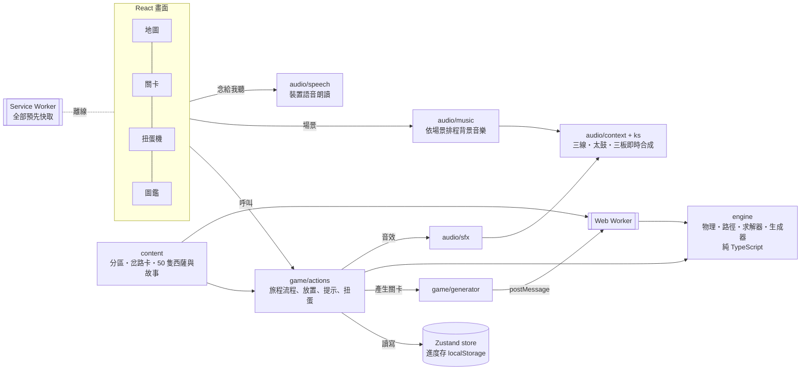

# 小獅搭路（暫名）發展計畫

> 狀態：v0.9.0（2026-10-17）。遊戲正式名稱還在討論，repo 暫名 `shisa-reunion`，畫面與安裝名稱暫用「小獅搭路」。

## 1. 目標

把家裡孩子在玩的實體搭路益智桌遊玩法，做成一款**可以安裝、沒有網路也能玩**的網頁遊戲，主要在平板和手機上玩。

- 核心玩法：用有重力、會倒的積木搭一條路，讓出發的西薩走到等待的西薩身邊
- 包裝：沖繩主題、roguelike 隨機關卡、分區難度、過關拿福氣幣抽扭蛋收集西薩
- 原型已在兩版 Artifact 驗證（v0.1 固定 16 關、v0.2 roguelike＋扭蛋），v0.3 起轉成正式專案

## 2. 版權與智慧財產評估（摘要）

完整理由與替代方案見 [ADR-0005](adr/0005-original-expression-ip-stance.md)。

| 項目 | 是否受保護 | 我們的做法 |
| --- | --- | --- |
| 遊戲規則、玩法、機制（搭路、重力、階梯） | **不受著作權保護**。台灣著作權法第 10 條之 1：保護「僅及於表達，不及於思想、程序、系統、操作方法、概念」；美國著作權局對遊戲的說明也相同 | 可以使用，並已自行延伸（竹梯、跳跳貝、溜滑梯、藤蔓、漲潮、石門機關、星砂等） |
| 美術、角色、包裝、說明文字 | 受著作權保護 | 全部原創：沖繩西薩（守護獅）、紅型／赤瓦／紅芋造型，不用騎士與公主，也不用城堡積木塗裝 |
| 官方 48 關題目卡 | 題目編排可能被認定為表達 | 不抄。關卡全部由程式當場產生、求解器驗證 |
| 名稱與商標（Camelot、SmartGames） | 受商標保護 | 遊戲名、安裝名、商店頁、宣傳都不使用；文件內只做事實性提及 |
| 整體外觀與手感（look and feel） | 美國 *Tetris v. Xio*（2012）判決：整體視覺近似可構成侵權 | 視覺風格刻意與原作不同 |
| 專利 | 公開資料查無 Camelot Jr. 的相關專利；原廠 Smart NV 有部分實體產品的設計專利（保護外觀，不及於數位玩法） | 個人與家庭使用風險低；**若要商業化，上架前請專業人士做一次侵權可能性檢索（FTO）** |
| 字型 | 源泉圓體（GenSen Rounded TW）與 Fredoka 皆為 SIL OFL 1.1 | 自託管子集字型，授權檔隨附於 `public/fonts/` |

結論：公開 repo、個人與家庭使用都沒有問題。之後若要商業化（上架、收費、廣告），再做一次正式的智財檢索。

> 本節是工程端的整理，不構成法律意見。

## 3. 架構



- **規則引擎與畫面完全分開**：`src/engine` 不碰 DOM，可單獨測試，也能拿去做關卡編輯器、實體挑戰卡產生器（[ADR-0002](adr/0002-pure-engine-and-worker-generator.md)）
- **關卡在 Web Worker 產生**：求解器跑重的時候不會卡畫面
- **同一個種子產生同一關**：旅程可以重現、方便回報問題

### 目錄

```
src/
  engine/      規則引擎：pieces（積木定義）、grid（重力、重心、藤蔓懸掛）、path（走路、爬梯、彈跳、溜滑梯、撿星砂路線）、solver、generator
  content/     遊戲內容：zones（分區、岔路卡、各站設定）、shisa（50 隻西薩、文化小故事與扭蛋抽法）、text（名稱與規則說明）
  state/       Zustand store；只有 progress 會存檔（分區用 id 記，舊存檔載入時自動升級），ui 是暫時狀態
  gacha/       可以用手操作的扭蛋機：physics（扭蛋在玻璃罩裡的重力、碰撞、滾動）、Machine（投幣、轉把手、出口）
  game/        旅程流程（actions）、拖放、走路動畫、手指拖曳示範、盤面與托盤元件、Worker 呼叫端
  art/         SVG 美術元件：積木、場景、機關、西薩、圖示
  screens/     地圖、關卡、扭蛋機、圖鑑
  story/       開場故事「西薩的故事」
  modals/      新積木說明、過關、岔路、旅程完成、扭蛋開獎、西薩故事與選擇出場、西薩是什麼
  ui/          主要按鈕（Cta）、閒置偵測、更新提示
  workers/     關卡產生 Worker
  audio/       ks（三線撥弦合成）、context（音軌與太鼓、三板）、music（背景音樂排程）、sfx（音效）、songs（曲目）、speech（念給我聽）
scripts/       字型子集化（pnpm fonts）、圖示產生（pnpm icons）
e2e/           Playwright 測試
docs/adr/      架構決策紀錄
```

## 4. 技術選型

| 範圍 | 選擇 | 決策 |
| --- | --- | --- |
| 框架 | React 19 + Vite 8 + TypeScript 7 | [ADR-0001](adr/0001-react-vite-typescript.md) |
| 狀態 | Zustand 5（persist、immer middleware） | ADR-0001 |
| 程式品質 | Biome 2（lint＋format） | ADR-0001 |
| 測試 | Vitest 5（單元）、Playwright（端對端，用系統 Chrome） | 本文第 10 節 |
| PWA | vite-plugin-pwa（Workbox generateSW） | [ADR-0003](adr/0003-offline-first-pwa.md) |
| 部署 | Vercel Hobby（個人帳號 aaronchuo） | [ADR-0004](adr/0004-vercel-hobby-hosting.md) |
| 套件管理 | pnpm 10 | — |

## 5. PWA 與離線

- 第一次打開就把整個遊戲（程式、Worker、字型、圖示）預先存進快取，之後完全不用網路
- 中文字型用源泉圓體（台灣字形的圓黑體，字的大小一致、筆畫圓潤，適合孩子看），只保留遊戲用到的 930 個字（一般與粗體各約 220 KB）。v0.8 前用的霞鶩文楷是手寫楷書，字的大小天生不一，孩子看起來忽大忽小，所以換掉。新增中文文字後執行 `pnpm fonts` 重建，單元測試會擋下漏掉的字
- 有新版本時，地圖畫面會顯示「有新版本可以更新了」，**由玩家決定何時更新**，不會在解題到一半時自動重新載入
- iPad／iPhone：用 Safari 打開 → 分享 → 加入主畫面。加到主畫面後，iOS 不會因為一段時間沒用就清掉進度
- 進度只存在該裝置。換裝置或清除網站資料後，收集會不見（雲端備份列在路線圖）

## 6. 音樂與音效

決策見 [ADR-0006](adr/0006-synthesized-sanshin-audio.md)。

- 三線、太鼓、三板全部用程式即時合成，不需要任何音訊檔，離線也能播
- 背景音樂依場景切換：

| 場景 | 曲子 | 由來 |
| --- | --- | --- |
| 地圖 | 島風 | 原創，琉球音階慢板 |
| 那霸港 | てぃんさぐぬ花 | 傳統童謠（鳳仙花） |
| 讀谷村 | 谷茶前 | 傳統舞蹈歌，谷茶在讀谷旁的恩納村 |
| 美麗海 | 唐船ドーイ | 傳統歌謠，唐船（中國的船）進港時的歡騰，常在宴會最後大家一起跳 |
| 古宇利島 | 花ぬ風車 | 傳統舞蹈歌 |
| 竹富島 | 安里屋ユンタ | 竹富島名曲（宮良長包 1934 年改編版旋律） |
| 西表島 | デンサー節 | 西表島上原流傳的八重山民謠 |
| 首里城 | 赤田首里殿內 | 首里流傳的童謠 |
| 扭蛋機、圖鑑 | 搭路小調 | 原創，輕快 |

- 每區最後一站：同一首曲子加快 8%，配上艾薩太鼓節奏
- 音效：放積木的音高隨高度沿琉球音階往上爬；彈跳是三線滑音；溜滑梯是一路往下滑的長音；攀藤蔓兩聲輕撥；撿到星砂是一串高音；石門打開兩聲太鼓；過關是一段琉球音階樂句加太鼓、三板

## 7. 內容：分區與西薩故事

決策見 [ADR-0007](adr/0007-culture-stories-and-read-aloud.md)。

| 分區 | 難度 | 新東西 | 最後一站 |
| --- | --- | --- | --- |
| 那霸港 | ★ | 基本積木 | 港口燈塔（海膽） |
| 讀谷村 | ★★ | 竹梯 | 殘波岬（竹梯＋海膽） |
| 美麗海 | ★★★ | 跳跳貝、石拱橋、漲潮 | 大浪灘（跳跳貝＋漲潮） |
| 古宇利島 | ★★★ | 溜滑梯：只能從高的那頭往下溜 | 心形岩（溜滑梯＋海膽） |
| 竹富島 | ★★★★ | 星砂：要先撿到才能去找朋友 | 星砂海灘（兩堆星砂） |
| 西表島 | ★★★★ | 藤蔓：掛在積木下面，可以攀上攀下（盤面 7 格寬） | 紅樹林（藤蔓＋海膽） |
| 首里城 | ★★★★★ | 石門壓板；所有積木和岔路卡都會出現 | 守禮之門（石門＋海膽） |

- 扭蛋六個系列共 50 隻：傳統、海洋、美食、祭典各 10 隻，動物、工藝各 5 隻；每個系列都有稀有款
- 每隻西薩附一段 50–75 字的小故事，講牠的由來、典故或沖繩文化，寫給大孩子自己讀、或爸媽念給孩子聽；圖鑑另有一頁「西薩是什麼？」
- 年份、數字、紀錄等具體事實都查證過；沒把握的細節寫得概括，不寫死
- 「念給我聽」用裝置內建的國語語音朗讀；日文詞一律寫成中文音譯在前、日文放括號，例如「西薩（シーサー）」，朗讀時只念音譯

## 8. 主角西薩與開場故事

決策見 [ADR-0010](adr/0010-shisa-name-and-opening-story.md)。

- 遊戲裡一律叫「西薩」（沖繩話シーサー的音譯，就是「獅子」）；每一隻叫「○○西薩」。英文 Shisa 只用在標誌、網址、英文名
- 第一次打開遊戲會播一本五頁的小繪本「西薩的故事」，地圖上的「故事」按鈕可以重看：
  1. 屋頂上的兩隻獅子，點一下牠會說「我是西薩！」，名牌跳出來
  2. 張嘴的把福氣接進來、閉嘴的把福氣守住（就是遊戲裡的出發和等待）
  3. 用手指撥一下吹起颱風，兩隻西薩被吹散
  4. 一塊石階掉下來，出發的西薩走上去找到朋友
  5. 「出發」直接開始第一關
- 每頁都會念出來（目前用裝置語音，之後換 Azure 旁白），有聲音開關和「跳過」
- 點地圖上方的兩隻西薩、或關卡裡的西薩，牠會說自己的名字；過關時喊「西薩團聚了！」

## 9. 不識字也會玩

決策見 [ADR-0008](adr/0008-buttons-for-children-who-cannot-read.md)。5 歲孩子試玩後的調整：

- 每個畫面只有一顆橘色、會呼吸的「主要下一步」，圖案在前、文字在後；孩子 4.5 秒沒動作就有手指點著它
- 其他按鈕白底、比較小，全部配圖示
- 少問一題：首頁自動選好下一站；扭蛋開獎只剩「換牠出場」和「先收著」；沒幣時主要按鈕變成「去玩，拿福氣幣」
- 用圖代替字：出發／等待用張嘴、閉嘴的獅子圖卡；獎勵與積木數量用圖示
- 第一關有手指示範拖曳，之後的提示也用手指示範；卡住 25 秒提示貝殼會搖

### 扭蛋機

每台扭蛋機的屋頂依系列有自己的造型，屋頂上坐著該系列的稀有西薩當大獎：傳統是赤瓦、海洋是捲浪和小魚、美食是一大碗沖繩麵、祭典是紅白棚和燈籠、動物是森林樹冠、工藝是織著敏沙花紋的釉色屋頂。把手和投幣口放大，把手上有紅色握把。扭蛋開獎時會從出口旋轉著飛到畫面正中央。


決策見 [ADR-0009](adr/0009-hands-on-gacha-machine.md)。把福氣幣拖進投幣口、手指按住把手轉一圈（只能順時針，每 90 度喀一聲），最下面的扭蛋就掉進出口，點它打開。玻璃罩裡的扭蛋數量就是這台還沒抽到的數量，會因重力堆在底部、碰撞、滾動；掉出一顆時其他顆滾下來補位。抽到誰仍由原本的公平規則決定，物理只決定哪一顆掉出來。點一下、或按主要按鈕也能完成每一步

## 10. 品質把關

| 層級 | 內容 |
| --- | --- |
| 單元測試 | 扭蛋物理（會停下、不重疊、會滾、掉一顆後其他顆補位）、積木物理（懸空平衡、石拱橋重心、有東西壓著就拿不起來、藤蔓只能掛在積木下面）、路徑（爬梯、彈跳、溜滑梯單向、攀藤蔓、海膽、漲潮、石門、星砂路線不能穿過終點）、每個分區 × 每一站 × 每張岔路卡都能產生公平關卡、同種子可重現、扭蛋不重複、故事長度與音譯、舊存檔升級、字型涵蓋 |
| 端對端測試 | 新玩家第一次打開會播開場故事（點西薩會說名字、撥一下吹起颱風、最後直接開始第一關）、可以跳過且之後不再自動播、地圖可重看；其他測試預設略過故事（`e2e/fixtures.ts`）；用滑鼠實際拖積木走完那霸港五站並抽扭蛋、首頁只有一顆主要按鈕且閒置會出現手指、第一關有拖曳示範且不扣提示貝、沒幣時扭蛋機改成「去玩」、拖幣進投幣口與畫圈轉把手才掉扭蛋（倒轉、沒投幣都不會掉）、扭蛋數量等於還沒抽到的數量、角色圖卡、古宇利島／竹富島／西表島第一站都能玩到過關、舊存檔升級後首里城仍開著、圖鑑故事朗讀只念中文音譯、離開後續玩、斷網後重新整理還能開始旅程、手機版面（Pixel 7 與 375×600 兩種尺寸：扭蛋分類都點得到、文字不壓在機台上、不會左右捲動） |
| CI | GitHub Actions：lint → type-check → 單元測試 → build → 端對端測試 |

## 11. 部署

- Vercel 專案在個人帳號 `aaronchuo's projects`，Hobby 方案（免費，限非商業用途）
- 連上 GitHub 後：推到 `main` 自動部署正式環境，其他分支與 PR 自動產生預覽網址
- `vercel.json` 讓 `sw.js` 不被快取，確保新版本能被發現；`/assets/*` 帶雜湊檔名，設為永久快取

## 12. 路線圖

| 版本 | 主題 | 內容 |
| --- | --- | --- |
| v0.3 | 架構化 | React 重構、PWA 離線、測試與 CI、部署 Vercel |
| v0.4 | 三線音樂與音效 | 依場景播放的三線背景音樂、三線／太鼓／三板音效 |
| v0.5 | 內容擴充 | 古宇利島、竹富島、西表島三個新分區與溜滑梯、藤蔓、星砂；扭蛋擴充到六個系列 50 隻，每隻附沖繩文化小故事與「念給我聽」 |
| v0.6 | 不識字也會玩 | 依 5 歲孩子試玩回饋：一個畫面一顆主要按鈕、全部配圖示、手指示範拖曳、少問一題 |
| v0.7 | 用手玩扭蛋機 | 拖幣投幣、手指轉把手、玻璃罩裡的扭蛋有真實數量與重力、碰撞、滾動 |
| v0.8 | 試玩回饋 | 主題扭蛋機屋頂、放大把手與投幣口、扭蛋飛出動畫、換成源泉圓體、手機首頁變短、平板按鈕與字放大 |
| **v0.9**（本版） | 認識西薩 | 開場故事「西薩的故事」、全面改叫西薩、點西薩會說話 |
| v0.10 | 語音與命名 | Azure 台灣國語旁白音檔、西薩角色音、正式命名（repo、manifest、畫面一起改）、繼續實機試玩與調難度 |
| v0.9 | 小孩體驗 | 「走走看」：路還沒通也能讓獅子走到卡住的地方；影子提示；岔路卡預覽關卡 |
| v0.10 | 家長 | 進度匯出／匯入或雲端備份、遊玩時間提醒 |
| 之後 | 延伸 | 關卡編輯器（小孩出題、求解器驗證）、實體挑戰卡產生器（用實體積木的數量出新題） |

## 13. 待決事項

1. **遊戲正式名稱**：repo 暫名 `shisa-reunion`（取「兩隻獅子重逢」），畫面暫名「小獅搭路」
2. **授權條款**：目前沒有附 LICENSE，等於保留所有權利。若想開源程式碼可選 MIT，美術另外約定
3. **待辦追蹤**：個人專案不放進公司 ClickUp，建議用這個 repo 的 GitHub Issues
